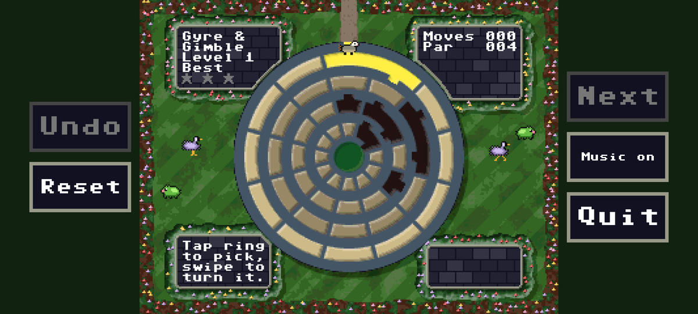
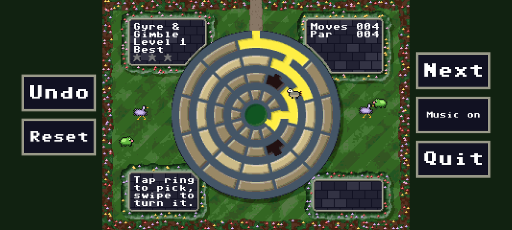
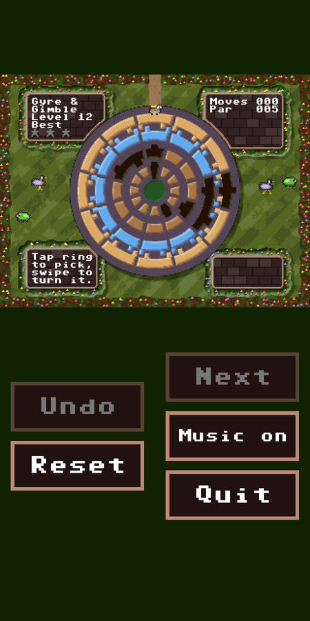
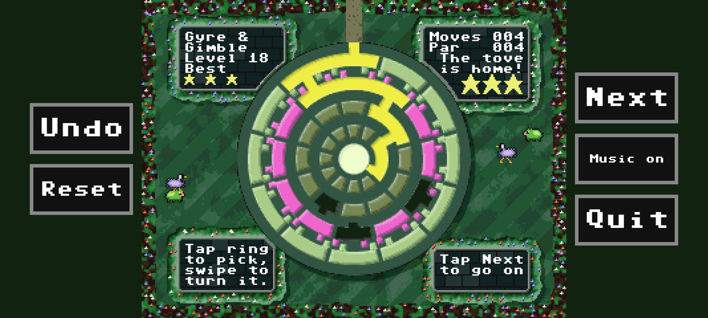

# Gyre & Gimble — mobile

Android and iOS port of [Gyre & Gimble](https://github.com/SlithyMatt/x16-gyre-and-gimble),
the rotating-rings puzzle game for the Commander X16.

The X16 repository is included as the `x16` submodule and stays the single
source of truth: the build runs its own Python tools (the same ones its
Makefile runs) to make the board graphics, garden, cell pieces, palettes,
sprites, sound effects, music and all 100 levels, then compiles the output
into the app. Change a level, theme, sprite or score in `x16/` and the next
build picks it up.

## Gameplay



Turn the rings until a tunnel runs from the gap in the outer rim to the
burrow at the center. Tap a ring to select it, then drag around the board
to turn it; each 30° is one move. The X16 screen is shown at a whole-number
scale, with the on-screen buttons beside it.



When the path connects, it lights up and the tove walks home along it
(**Next** skips the walk).



Gimbals arrive from level 5: rings whose gear teeth mesh turn together.
Select a ring and any ring it will drag is tinted blue (same direction) or
mauve (opposite). In portrait, the buttons sit below the board.



Each solve earns 1–3 stars against the level's par; the best for each
level is kept. There are 100 levels, in three gardens, each with its own
music.

## How it works

- `src/game.c` ports `x16/src/main.asm` routine by routine (same names, same
  8-bit arithmetic): the ring logic, flood fill, gimbals, undo, stars, the
  tove's walk, the critters, the HUD and the ending.
- `src/vera.c` models the parts of VERA the game uses (8bpp bitmap layer,
  40×30 text layer with the X16 PETSCII font, 4bpp sprites, the 12-bit
  palette), so the game draws exactly as it does on the X16.
- `src/audio.c` and `src/music.c` model the VERA PSG and PCM FIFO (after
  x16emu) plus the YM2151 (ymfm), and the music sequencer runs on a 60 Hz
  "VSYNC" tick on the audio thread, as it does from the X16's interrupt.
- `tools/export_data.py` runs the X16 tools and turns their `.inc`/`.BIN`
  output into `gg_data.c`/`gg_data.h` with a small ca65 data assembler.
- `src/main.c` is the SDL2 platform layer: scaling, on-screen buttons,
  touch, controllers, audio device, app lifecycle and saved progress.

## Controls

| Touch | SNES-style pad | X16 key | Action |
| --- | --- | --- | --- |
| Tap a ring | D-pad up / down | W / S | Select a ring |
| Drag around the board | D-pad left / right | A / D | Turn the selected ring (a step per 30°) |
| Swipe up / down off the rings | | W / S | Select the next ring out / in |
| Swipe left / right off the rings | | A / D | Turn the selected ring |
| **Undo** button | B | U | Undo |
| **Reset** button | Select | R | Restart the level |
| **Next** button | A or Start | Return | Skip the walk / next level / play again |
| **Music** button | | M | Music on / off |
| **Quit** button (tap twice) | | Q | Quit |

Controllers are read by position, as SNES buttons (south = B, east = A,
west = Y, north = X), the same mapping x16emu uses; held D-pad directions
repeat after 18 frames, then every 8. Any number of controllers can be
connected; the left stick works as a D-pad. A keyboard works too.

Progress (current level, best stars per level, music setting) is saved
on the device; the X16 version keeps it for the session only.

## Getting the source

```sh
git clone --recursive https://github.com/SlithyMatt/mobile-gyreandgimble.git
# or, in an existing clone:
git submodule update --init --recursive
```

Every build needs **Python 3** (3.8+) on the build machine, for the X16 tools.

## Building

### Android

Needs Android Studio (or the Android SDK command-line tools) with NDK
27.2.12479018 and CMake 3.22.1+. Open `android/` in Android Studio and run,
or from the command line (Gradle 8.11.1+):

```sh
cd android
gradle wrapper        # once, to create ./gradlew
./gradlew assembleDebug
./gradlew installDebug
```

### iOS

Needs Xcode and CMake 3.20+:

```sh
cmake -S . -B build-ios -G Xcode -DCMAKE_SYSTEM_NAME=iOS -DGG_TEAM_ID=YOURTEAMID
open build-ios/GyreAndGimble.xcodeproj
```

Pick the `GyreAndGimble` scheme and a device or simulator. The bundle ID
defaults to `com.slithymatt.gyreandgimble` (`-DGG_BUNDLE_ID=...` to change).

### Desktop (for testing)

```sh
cmake -S . -B build && cmake --build build
./build/gyre            # keyboard help text, as on the X16
./build/gyre --touch    # the touch help text; the mouse drags and swipes
```

`--size WxH` sets the window size (try a tall one for the portrait layout).
`--keys STRING` types X16 keys at startup, and `--shot FILE.bmp` saves the
window after `--wait MS` (default 1500) and quits, leaving saved progress
alone. The screenshots above were made this way, for example:

```sh
./build/gyre --touch --size 1200x540 --keys sssddwdwa --wait 1300 --shot walk.bmp
```

Add `-DGG_SYSTEM_SDL=ON` to use an installed SDL2 instead of the submodule.

## Tests

```sh
cmake --build build --target joytest && ctest --test-dir build
```

`joytest` replays the X16 repo's own scripted pad (`x16/tools/joyscript.py`,
the same script as its `make joytest`) through all 100 levels to the ending,
checking for 300 stars, then solves level 1 again with touch gestures.

## Third-party code

- [SDL2](https://libsdl.org) 2.32.10 (zlib license), submodule `third_party/SDL`
- [ymfm](https://github.com/aarongiles/ymfm) (BSD-3), the YM2151 core files
  in `third_party/ymfm`, copied from the x16-emulator's copy
- The X16 PETSCII charset (public domain), extracted by
  `tools/extract_font.py` into `src/font_petscii.h`
- PSG/PCM behavior and volume tables follow
  [x16emu](https://github.com/X16Community/x16-emulator) (BSD-2)
